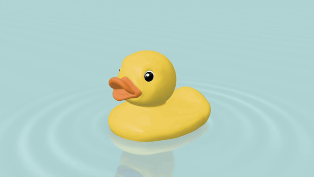

# EZPZ Rubber duck

[](https://21st.dev/@ezam0000/components/ezpz-rubber-duck)

[Try it live](https://21st.dev/@ezam0000/components/ezpz-rubber-duck)

Squeeze, drag, release. A 3D rubber duck with ripples and a little squeak.

## Use

```sh
npm ci
npm run dev
```

Import `RubberDuck` and `style.css`. Give its parent a height. Customize `color`, `sound`, `initialYaw` and `className`.

Touch, mouse and keyboard supported. Respects reduced motion. Requires WebGL.

MIT code; SCEA-licensed model. [Full notices](THIRD_PARTY.md).
